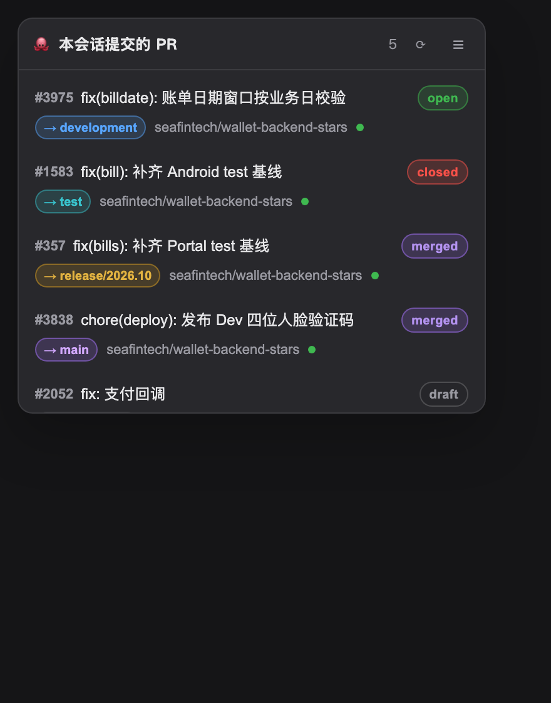
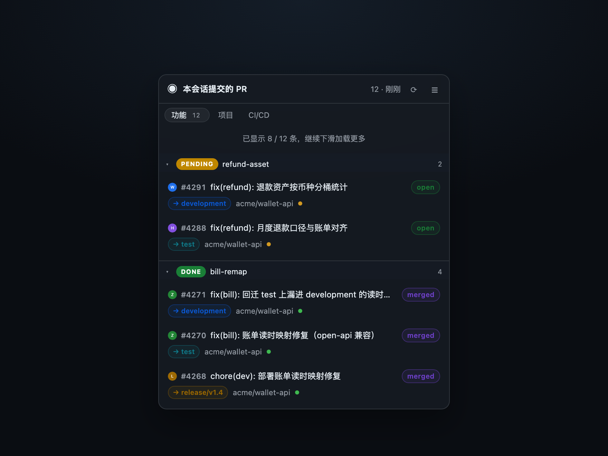
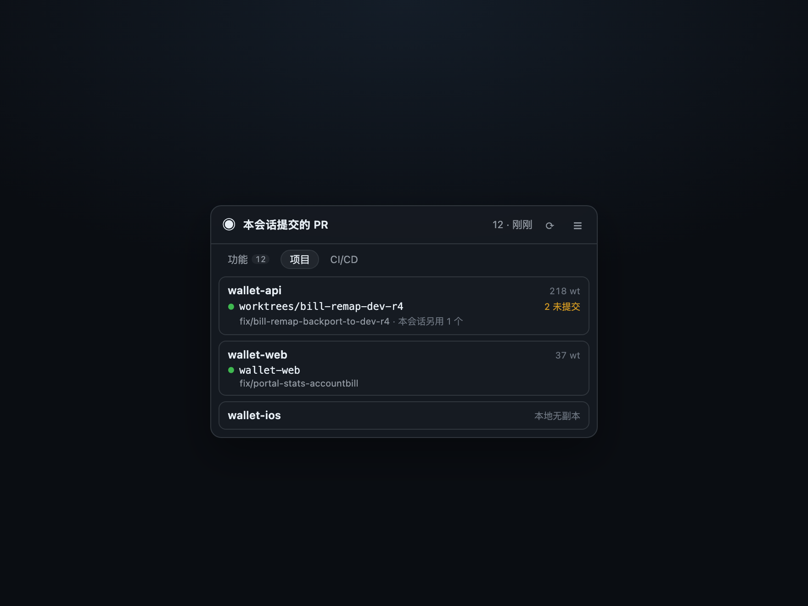
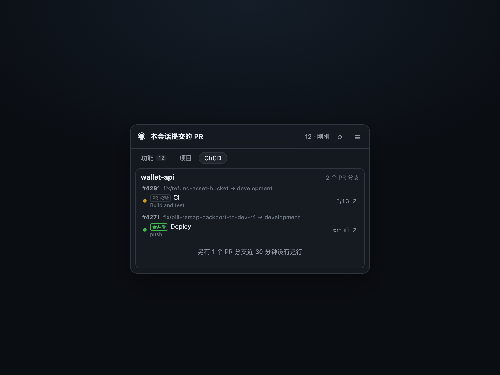
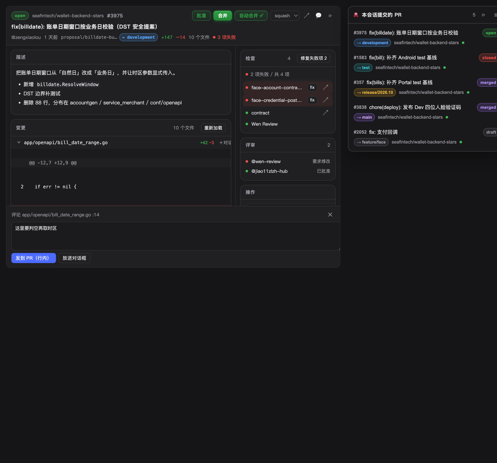
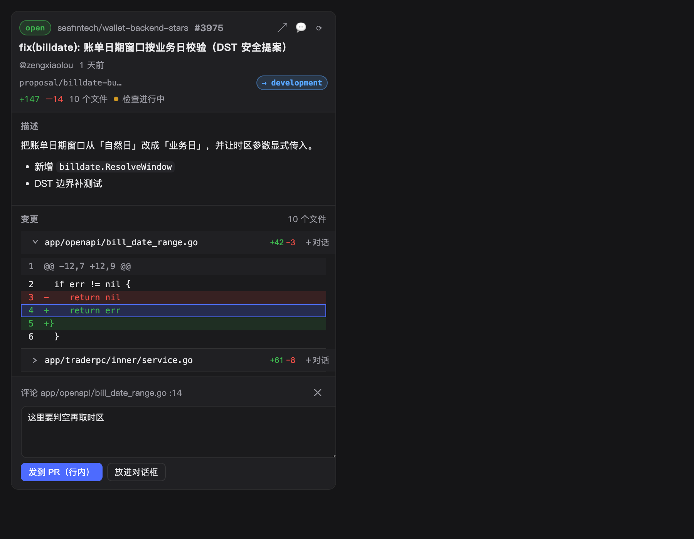
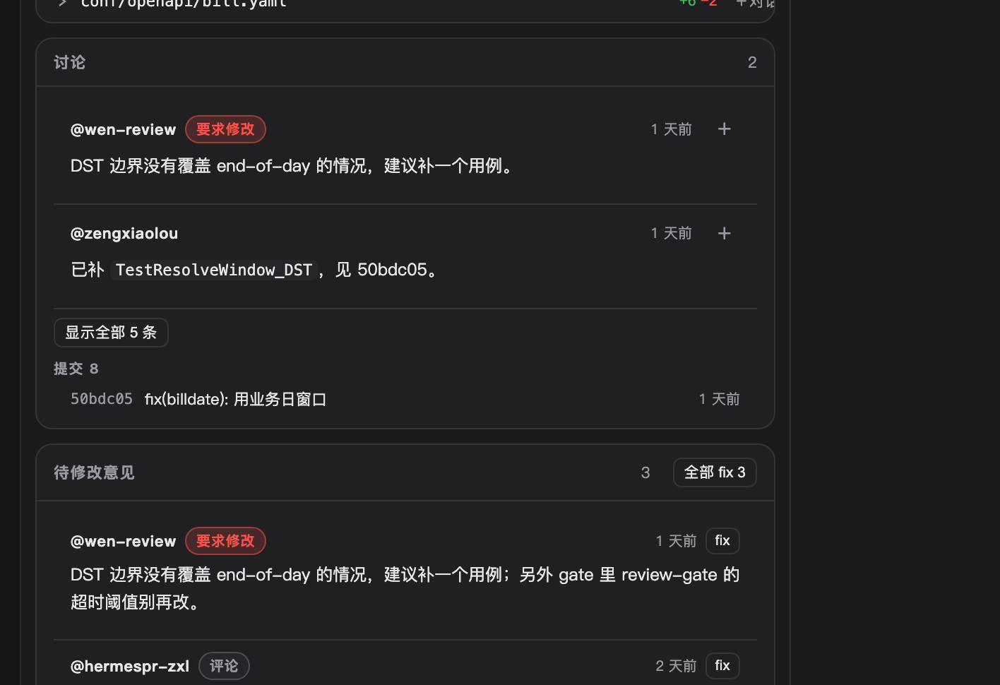

# dsh-pr-panel

**本会话 PR 浮窗 + 右列审阅面板。** Agent 说「PR 已创建」之后，你不用切浏览器：右下角留一个入口，点开就是状态、CI、评审意见与合并按钮。

> 前身是 [dsh-github-flow](https://github.com/ItQianChen/dsh-github-flow) 的本地分叉；这一版只保留本会话 PR 通道与 Agent 的 `github_*` 工具集。从旧版裁剪掉的部分见文末「历史」。

## 装 / 启用

```bash
# npm
dsh plugin --profile <profile> add dsh-pr-panel
# 离线 tarball
dsh plugin --profile <profile> add ./dsh-pr-panel-0.1.0.tgz
```

装完**完整重启一次 DSH**：客户端 bundle 会热重载，Host 侧路由不会。重启后右下角才会出现浮窗、右列才会注册 `PR` 标签。

凭证零侵入：所有请求复用宿主机的 `gh` 登录态（`gh auth status` 能过就能用），不额外存 token。

## 三个入口

| 入口 | 位置 | 说明 |
| --- | --- | --- |
| 浮窗 | 右下角 `shell.overlay` | 本会话至少建过 1 个 PR 才出现；收起是 `PR #<最新>` 药丸，展开是 12 行卡片。可拖动（位置存 localStorage，双击把手归位），右键每行「在面板里打开 / 复制链接 / 跳转 GitHub」 |
| 右列面板 | 右栏 `PR` 标签 | 点浮窗任意一行，或以 `number`（+ `repo`）参数打开标签；容器 <620px 时卡片叠成单列 |
| 对话里的 PR 链接 | 任意 `github.com/<o>/<r>/pull/<n>` | 直接在本地面板打开（读本地 `gh`，秒开），不再跳没有登录态的内嵌浏览器；Shift / ⌘ + 点击维持网页版 |



### 浮窗的三个视图

浮窗顶部分三块，一次只渲染一块（藏起来的视图不发请求）：

| 功能 | 项目 | CI/CD |
| :---: | :---: | :---: |
|  |  |  |

- **功能**：按分支链把同一个功能的 PR 收进一条泳道。泳道头是完成度（`PENDING` / `DONE` / `CLOSED`），不是环境；环境在每行的 `→ 目标分支` 上。列表先给 20 条，滑到底续 20 条。
- **项目**：本会话涉及的每个项目，显示**它当前正在用的那个 worktree**（按 PR 的 head 分支反查，git 里一个分支只属于一个 worktree），以及该仓库共有多少个 worktree。
- **CI/CD**：本会话 PR 触发的 Actions。分两段：`PR 校验`（head 分支）与`合并后`（base 分支、合并后 30 分钟内）。运行中显示 `3/13` 与当前步骤，点整行打开该次运行。

> 截图取自 [`docs/preview`](docs/preview) 的离线预览页：用插件自己的 CSS 与组件标记渲染，数据是示例值（不含真实仓库信息）。重新生成：
>
> ```bash
> node docs/preview/build-previews.mjs
> ```


## 面板能力

左栏四张卡（描述 / 变更 / 讨论 / 待修改意见），右栏三张卡（检查 / 评审 / 操作），每张独立边框、独立骨架屏：

| 卡 | 内容 |
| --- | --- |
| 描述 | PR 正文 markdown，默认整段展示，超长渐变遮罩 +「展开全部」；按行边界截断，未闭合代码围栏自动补齐 |
| 变更 | 文件清单（详情自带，零额外请求）+ 按需「加载 diff」；逐文件折叠，默认展开第一个；点行号可就地评论 |
| 讨论 | 最近 3 条评审/评论，`显示全部 N 条`；提交默认 6 条；每条可 `＋` 引用进对话框 |
| 待修改意见 | 只收要动手的：非空正文、非 APPROVED 的评审 + 非作者本人的评论；最新在前，每行 `fix`，卡头 `全部 fix N` |
| 检查 | `N 项失败 / 共 M 项` 汇总；失败项整行红底，逐项 `fix`，卡头 `修复失败项 N` |
| 评审 | 评审人与结论徽标（已批准 / 需要修改 / 待评审） |
| 操作 | 请求修改、发 PR 评论（自己的 PR 也能发）、合并后删除源分支开关 |



窄面板（<620px）下卡片自动叠成单列：



头部就是审批台：`批准`、`合并`、`自动合并`、合并方式下拉（按仓库 `allow_*_merge` 过滤）。合并两步确认——5 秒内再点一次才真的合。

## 门禁与 fix 提示词

**门禁**：按钮可用性跟着 PR 状态走，禁用理由写在按钮同一行（`不能合并：1 项检查未通过 · 评审要求修改`），优先级按「先修什么最划算」：草稿 → 冲突 → 检查未过 → 评审要求修改 → 分支保护。`DIRTY` 禁批准与合并；`BLOCKED` 只禁合并（批准仍有意义）；**自动合并始终可用**——它本来就是「条件满足再合」的入口。写操作服务端回读确认（`gh pr merge` 对已合并 PR 的退出码仍是 0），状态没真的变就 502 并带回 gh 原始输出。

**fix 提示词**：检查卡的 `fix` 不是一句「帮我修 CI」，而是一段可执行工单——坐标（`owner/repo#编号`、目标分支←源分支、当前 HEAD、评审结论）、失败项（检查名 + workflow + 详情 URL + 是否评审门禁）、步骤（先 `gh run view --log-failed` 定位 → 最小改动 → 本地等价命令 → 推源分支 → `gh pr checks --watch` 确认真的重跑 / `gh run rerun --failed` → 门禁类要重新请求评审）、完成标准。评审意见的 `fix` 按编号批量拼成一条消息，带「新提交才算处理完 → 重新请求复审 → 对应 thread 回复并 resolve」收尾。提示词经 `inputActions.insertText` 进输入框（拿不到退 `setDraft`，再退剪贴板），只等你按回车。



## 取数与缓存

| 策略 | 做法 |
| --- | --- |
| 批量 GraphQL | 同仓库 PR 合并成 1 次别名查询：12 条约 1.6s，而不是 12 次 `gh pr view` 的 5.8s；GraphQL 不可用时逐条 REST 兜底 |
| core / thread 拆分 | 先出 core（描述 / 检查 / 操作，约 1.5s），reviews / comments / commits 并行后补并缓存 30s |
| 按文件补丁 | 整份 diff 撞 GitHub 20000 行上限时改走 `/api/github/pr-files` 逐文件取 patch，不受整体上限约束 |
| 磁盘快照 | 成功结果落盘到插件数据目录（`session-pr-snapshot.json`），重启后首拍直接返回（毫秒级），下一拍换真数据 |
| TTL | 列表元数据 30s · 详情 core 8s · 讨论 30s · 文件补丁 60s · 合并方式 300s · 转写重扫 30s；diff 不缓存 |
| 会话血缘 | 只解压每个转写的第一行（4–5ms/份）读 `parentSession`，BFS 出主会话 + 子代理会话；头按路径永久缓存 |
| 轮询分档 | 面板 / 卡片展开 8s，只有药丸 30s，窗口后台停；每 3 拍穿透一次 host 缓存；连续失败按 ×2…×8 退避 |
| 数据量 | 合并后最多 12 条进元数据阶段；元数据缓存 240 条 LRU |

## 测试

`test/` 下是 **39 个相位**（编号在 `phase1`–`phase44` 区间；随旧界面一起删除的 phase7 / 11 / 12 / 13 / 21 已剔除），全量封闭测试：所有 `gh` 调用都被桩替换，不需要网络、token 或凭证。

```bash
node test/run-all.mjs   # 等价于 pnpm test
```

CI 见 `.github/workflows/test.yml`：push 任意分支 + PR 触发，Node 20 上只跑测试（不构建、不发包）。失败即真实回归，不是环境噪音。

## 开发

```bash
pnpm install
pnpm build        # build:css → tsc → build.mjs，产物在 lib/
pnpm test         # node test/run-all.mjs
```

样式是**构建期** Tailwind：`src/ui/tw.src.css` 由 CLI 生成 CSS，`scripts/build-css.mjs` 包成 `tw.generated.ts`，最后拼进单个 `<style>`。`corePlugins.preflight = false`，避免基础重置污染宿主全局样式。客户端运行时只依赖宿主提供的 `react`。

## 已知限制

- **Host 路由要重启才注册**：`session-created-prs` 返 404 时，先完整重启 DSH。
- **浮窗会自己消失**：本会话没建过 PR 就不渲染，刻意如此。
- **最多 12 条**：更早的 PR 需要回 GitHub 看（按创建时间倒序，子代理建的新 PR 不会被挤掉）。
- **单文件 diff 400 行封顶**：看全量请点「在 GitHub 打开」。
- **子代理会话按转写头还原，最深 4 层**：子代理建的 PR 会带「子代理」小标一起收进来；血缘依赖子会话与主会话在同一工作区（DSH 默认行为）。
- **跨重启回填依赖系统 `zstd` 命令**（Node 20 的 zlib 没有 zstd API）；缺了会表现为「刚提的看得见，重启后历史 PR 消失」，子代理的 PR 也不可见（血缘同样要读转写头）。
- 实现细节见 [docs/session-pr-channel.md](docs/session-pr-channel.md)。

## 历史

本仓库由 `dsh-github-flow` 裁剪而来：仓库面板、同步设置、Issue 工作台、使用指南与升级提示均已移除，只保留本会话 PR 通道与 Agent 的 `github_*` 工具集。取数、门禁与交互上的取舍记录在 [PROJECT.md](PROJECT.md)。
