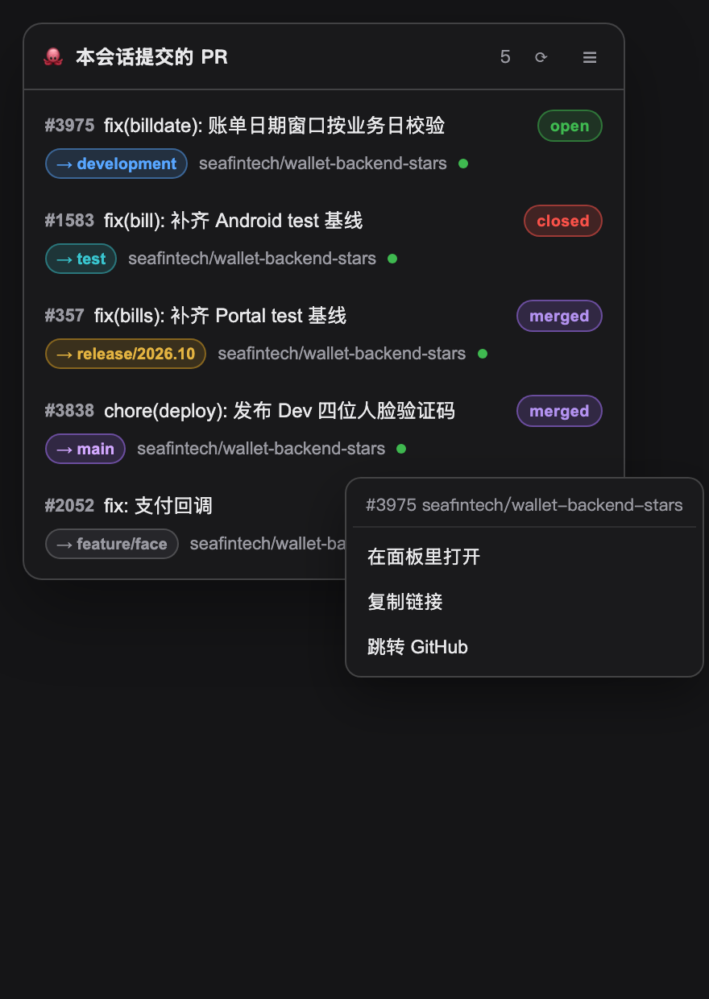

# 会话 PR 通道（Session PR Channel）

> 一句话：**本会话（含它派下去的子代理）创建的 PR，永远在右下角留一个入口。**
>
> 这份文档记录**会话 PR 通道**：早期版本里的全局入口与仓库工作台已经移除，PR 回到它真正的归属——当前这个会话。

---

## 1. 为什么做（会话级清单，不是全局视图）

人真正关心的问题只有一句：**我刚提的那个 PR，CI 过了吗？合了吗？** 账号视角的「我名下有多少仓库、多少开放 Issue」回答不了这个——它不知道你刚提了什么，只会把仓库里所有开放 PR 再列一遍。于是出现最尴尬的体验：Agent 说「PR 已创建」，用户却要切到浏览器确认。

所以本插件只做一条**会话级** PR 通道：只服务「本会话创建了什么」，分浮窗与右列面板两个界面。

判断标准只有一条：**这个 PR 是不是本会话（整棵树）建出来的。** 提过的、看过的、评审过的一律不收——混进来，浮窗就退化成第二个 PR 列表。子代理会话算同一个会话：活是主会话派出去的，PR 也在同一个对话里出现。

### 1.1 已移除的部分

**全局驾驶舱、仓库面板、Issue 工作台、同步设置已整体移除**：插件不再注册左侧导航入口、中央 `main` 面板与工作区仓库视图，README 里那些旧截图对应的界面均已作废。与 PR 无关的数据面请改用对话里的 `github_*` 工具，或直接开 GitHub 网页。

旧接口 **`/api/github/session-prs`**（「对话里提及过的 PR」，提及即收）仍保留在 Host 路由里做兼容，但已经没有界面消费它，与本文「只认本会话新建」的口径互不干扰。

---

## 2. 两个界面

### 2.1 右下角浮窗（`shell.overlay`）

| 项目 | 值 |
| --- | --- |
| 标签类型 | 右列标签 `kind: github`、标题 `PR`，按 `params.number` 分派：有编号→PR 面板；无编号→一条「怎么打开」的说明（仓库视图已移除）。单独注册的第二个类型 `github-pr` 在某些页面状态下会 `active:false`，表现为「标签在、内容空白」，因此没有采用 |
| 挂载点 / 位置 | 槽位 `shell.overlay`（`id: github-session-pr`, `order: 70`）；`fixed; right: 20px; bottom: 148px; z-index: 900` |
| 渲染条件 | **当前会话至少创建过 1 个 PR**，否则直接 `return null` |
| 收起态 | 药丸：`PR #<最新编号>` + 总数角标（仅 >1 时显示） |
| 展开态 | 372px 卡片，最多 12 行，**每行两行信息** |

**可以拖。** 卡片标题栏、以及收起态的药丸都是拖拽把手：

- 拖动即移动，松手后位置写入 `localStorage`（`dsh-pr-panel:overlay-pos`），刷新/重开后仍在原地；
- **双击把手归位**（回到右下角默认位置，并清掉存储）；
- 位移小于 4px 不算拖拽——否则「点一下打开」会被手抖变成「拖了一下」；真拖过之后那一次 `click` 也会被吞掉，不会拖完顺手展开卡片；
- 位置做了夹紧：至少保留 80px 在视口内，拖到屏幕外也能再抓回来。

**右键任意一行**弹出菜单：`在面板里打开` / `复制链接` / `跳转 GitHub`。

- 左键 = 直接进面板（无需先开菜单）；
- 右键菜单出现在鼠标坐标处，点别处 / `Esc` / 滚动都会关掉；
- `复制链接` 写剪贴板并在浮窗上方给一条短提示（剪贴板不可用时提示里直接给出链接，不让用户空手）；
- `跳转 GitHub` 走插件注入的 `onOpenUrl`——也就是「DSH 内置浏览器优先，失败回落系统浏览器」那条通道，不是裸 `window.open`。



每行两行：
- 第一行：`#编号` + 标题（单行截断，吃满宽度）+ 状态徽章（`open` / `draft` / `merged` / `closed`）；
- 第二行：目标分支色标 → 仓库名 →（子代理建的带 `子代理` 小标）→ CI 圆点（绿通过 / 红失败 / 黄进行中 / 灰无检查）。

**增删行数（`+147 −14`）不在卡片上**：它是「PR 大小」的弱信号，却要挤掉标题宽度——标题能多看十几个字更值钱；需要看增删时点进面板，头部与文件列表都写着。卡片头部有刷新与收起，点任意一行打开右列面板。


### 2.2 右列 PR 面板（`github` Tab，标题 `PR`）

**卡片式布局**：左栏四张卡（描述 / 变更 / 讨论 / 待修改意见），右栏三张卡（检查 / 评审 / 操作），每张都是圆角卡片、独立边框；容器 <620px 时叠成单列。


**头部就是审批台**：`批准`、`合并`、`自动合并`、合并方式下拉（squash / merge / rebase），右边才是 `在 GitHub 打开` / `推到对话框` / `刷新`。

- **批准** → `POST /api/github/pr-review-submit`（APPROVE）。草稿、有冲突时禁用并在 tooltip 写明原因；已合并/已关闭的 PR **整组按钮不渲染**（没意义的东西不该占位）。
- **点了之后有没有真的生效，服务端会回读确认**：`gh pr merge` 对「已合并 / 已关闭」的 PR 会打印一行提示但**退出码仍是 0**——只看退出码就会谎报成功（本地实测过）。所以合并路由是三段式：先读状态（已合并/已关闭直接 400）→ 执行 → 再读一次状态（要求 `MERGED` / `autoMergeRequest` 真的变了），没变就 502 并把 gh 输出一起带回来。评审路由同理：已合并/已关闭、或「批准自己的 PR」提前 400，而不是回一个看不懂的 `HTTP 422`。
- **禁用要看得出来，理由要写在脸上**：有失败检查 / 评审要求修改 / 有冲突时，合并按钮变成灰色禁用，并在同一行给出「不能合并：1 项检查未通过 · 评审要求修改」。优先级按「先修什么最划算」排：草稿 → 冲突 → 检查未过 → 评审要求修改 → 分支保护。批准按钮在「你已经批准过」时也会禁用（防止重复提交 APPROVE）。


- **按钮可用性跟着 PR 状态走**：`OPEN + CLEAN` 全开；`DIRTY` 禁用批准与合并（提示先解冲突）；`BLOCKED` 只禁合并（分支保护未满足，但批准仍然有意义）；`DRAFT` 禁批准与合并；**自动合并始终可用**——它本来就是「现在还不能合、等条件满足再合」的入口。
- **合并** → 两步：第一次点变成「确认合并？」，5 秒内再点才真的调 `POST /api/github/pr-merge`（`gh pr merge --squash|--merge|--rebase`）。合并会改写远端历史，不做二次确认太危险。
- **自动合并** → 同一个路由的 `--auto`（等价于 GitHub 的 Auto-merge）；已经开启时按钮显示 `自动合并 ✓`，再点发 `--disable-auto`。注意：仓库没开分支保护/必过检查时 GitHub 会直接拒绝，错误原样弹在面板上——这是 GitHub 的规则，不是插件吞了。
- **合并后删除源分支**：默认**不删**，要在「操作」卡里勾 `合并后删除源分支` 才会带 `--delete-branch`。删分支不可逆。

- **diff 是懒加载的**：进面板不发 `pr diff`。变更卡头部先给文件清单（`pr.files` 详情自带，零额外请求）+ 一颗「加载 diff」按钮；点下去才 `GET /api/github/pr-diff`，加载中显示骨架行，回来后逐文件折叠，默认只展开第一个。
  为什么：一个 181 文件的 PR，`gh pr diff` 可以跑满 30 秒甚至直接 406（GitHub 20000 行上限）——diff 不是这块的重点，不该挡住整个面板。
- **错误不是原文直译**：`gh: Unprocessable Entity (HTTP 422)` 会被翻译成「PR 状态已变、或分支保护/评审规则不满足（原始报错：…）」，401/403/404/冲突/限流/超时各有对应说法，括号里保留原文方便对照。
- **描述默认整段展示 + 渐变遮罩 +「展开全部」；截断按行边界切，未闭合的代码围栏自动补齐，不会渲染出半截标签。
- **讨论卡**：默认显示最近 3 条评审/评论，`显示全部 N 条` 展开；提交记录默认只列 6 条。
- **检查卡**：顶部一条汇总（`N 项失败 / 共 M 项`），失败的检查项整行红色高亮；超过 6 项折叠。
- **高亮**：正在评论的文件行整行高亮（`ghsp-file.active`），被点选的行有描边（`ghsp-line.sel`），失败检查红底、警告琥珀、通过绿点。
- **骨架屏**：详情未回来时标题写「正在读取 PR…」，右栏不渲染空卡片；各卡片各自有骨架条，而不是整页白屏。
- **浮窗让位**：面板挂载时浮窗自动收起（挂载计数，模块内自洽，不读宿主 DOM）。

### 2.2.1 「待修改意见」队列的口径

只收**需要动手**的东西，不把历史评论倒一遍：

- 评审：正文非空、且结论不是 `APPROVED`（批准是结论，不是待办）；
- 评论：正文非空、且作者**不是 PR 作者本人**（自己回的「收到」「已改」不进队列）；
- 排序：最新在前；默认展示 4 条，其余「显示全部 N 条」；
- 每条：作者、结论徽章、时间、正文（超过 8 行折叠）、`fix`；
- 卡头 `全部 fix N`：把所有条目按编号拼成一条消息推进输入框——一次说清，Agent 不用被同一批意见打断 N 次。

### 2.2.2 从聊天里点 PR 链接会落到哪

对话里点 `github.com/<owner>/<repo>/pull/<n>` 这类链接，**不再**跳内嵌浏览器的 GitHub 网页，而是直接打开我们的 PR 面板（读本地 `gh`，秒开）。

为什么改：内嵌浏览器没有 GitHub 登录态，PR 页面会一直转圈或空白——用户看到的就是「点了没数据」。面板走本地 CLI，不依赖浏览器登录。

- 想真的去看网页版：**Shift+点击 / ⌘+点击** 维持默认行为；
- 非 PR 链接（issue、tree、commit）不受影响；
- 面板内的普通链接仍走「内置浏览器优先」。

### 2.3 面板里的动作

| 动作 | 触发 | 落到哪 |
| --- | --- | --- |
| **推到对话框** | 头部 💬 / 右栏「推到对话框」/ 每个文件的 `＋对话` | `inputActions.insertText()`（拿不到退 `setDraft`，再不行写剪贴板），内容含 `owner/repo#编号`、标题、分支、增删与「先看 diff 再动手」 |
| **评论这一行** | 点 diff 里任意 `+` 行或上下文行的行号；**Shift+点击** 选一段（同一文件内） | 底部评论条（单行 `:12`、区间 `:12–18`）：`发到 PR（行内）` → `POST /api/github/pr-inline-comment`（区间带 `start_line`/`start_side`）；`放进对话框` → 变成一条「我要求这样改」的任务 |
| **批准 / 请求修改** | 右栏「操作」 | `POST /api/github/pr-review-submit` → `gh api .../pulls/N/reviews`。草稿或非 OPEN 的 PR 按钮直接禁用；自己的 PR 会被 GitHub 拒绝，错误原样显示 |
| **PR 评论** | 右栏「发到 PR 评论」 | `POST /api/github/pr-comment`（issue comment，自己的 PR 也能发） |
| **合并 / 自动合并** | 头部按钮；合并方式下拉**按仓库 `allow_*_merge` 过滤** | `POST /api/github/pr-merge`（`merge` / `auto` / `disable-auto`），见 2.2 |
| **修复失败的 CI** | 检查卡里失败项右侧的 `fix`，或卡头 `修复失败项 N` | 生成一段**可执行**的提示词：坐标（仓库#编号 / 目标分支←源分支 / 当前 HEAD / 评审结论）、失败项（检查名 + workflow + 详情 URL）、然后是「先读 `--log-failed` 定位 → 最小改动 → 本地跑等价命令 → 推到源分支 → `gh pr checks --watch` 确认重跑 / `gh run rerun --failed` → **重新请求评审** → 按固定格式回报」，最后写明完成标准 |
| **修复评审意见** | 「待修改意见」卡每条右侧的 `fix`，或卡头 `全部 fix N` | 单条引用原文；批量按 `### 1) @作者 · 结论` 编号，一次推给 Agent。两种都带收尾步骤：**新提交才算处理完** → 推源分支 → `--add-reviewer` 重新请求复审 / 在 PR 里 @ 评审人 → 对应 thread 回复并 resolve → 回报 |
| **引用评审意见** | 讨论块每条意见的 `＋` | 引用原话进对话框 |

行号不是数出来的：`diffLinesWithNumbers()` 从 `@@ -a,b +c,d @@` 推新文件行号，只有新增行与上下文行可评论（删除行在新文件里没有行号）。

## 3. 数据口径：只认「本会话新建」

口径里的「本会话」是**整棵会话树**：主视图会话 + 它派下去的子代理会话（含孙代理）。发版、并行工作面这类活常常派给 subagent 去做，PR 写在子会话的转写里；只认主会话就会漏掉一大半，「我刚提的 PR 呢」直接问不出来。

| 创建方式 | 计入 | 判定依据 |
| --- | --- | --- |
| `github_pr` → `action: "create"` | ✅ | 调用参数 + 结果里的 PR 链接；`dry_run: true` 排除 |
| `bash` 执行 `gh pr create` | ✅ | 命令命中 `\bgh\s+pr\s+create\b` + 输出里的 PR 链接 |
| `github_api` → `POST .../pulls` | ✅ | 方法为 POST 且端点为 `/pulls`（`/pulls/<n>` 不算） |
| 子代理会话里用上面三种方式建的 | ✅ | 先按会话头 `parentSession` 还原血缘（见第 4 节），再逐会话套同一口径；行上标 `origin: "subagent"` |
| 提及 / 查看 / 评审 / 合并 / 被指派 | ❌ | 属旧口径，见下 |

被排除的那类由 **`/api/github/session-prs`** 提供（「对话里出现过的 PR」，提及即收）。该接口为兼容旧版保留，已无界面消费。两个接口**刻意不合并**：一个答「我刚提了什么」，一个答「这会话聊到过哪些 PR」，混在一起两边都不准。

---

## 4. 三条来源，Host 侧合并

**① 进程内登记簿（快，但会丢）** — [src/session-pr-tracker.ts](../src/session-pr-tracker.ts)：`Map<sessionId, CreatedPrRef[]>`，`github_pr create` 成功后**同步**写 `{ repo, number, at, via: 'tool' }`，不等落盘。理由：转写是异步写文件的，解压扫描又整份做；只靠转写，点完「创建 PR」要等几秒才看见浮窗。上限 80 条/会话、120 个会话。

**② 转写回填（慢，但跨重启）** — [src/session-pr-scan.ts](../src/session-pr-scan.ts)：扫 `~/.dsh/sessions/<workspace>/<sessionId>/session.v4.jsonl.zstd`，`zstd -dc` 解压后逐行解析 `tool/call` 与 `tool/result`，按第 3 节口径配对：**只有「创建类调用 + 结果里出现 PR 链接」才算**。重启后历史 PR 由这条路找回。

**③ 会话血缘（决定①②扫哪些会话）** — [src/session-lineage.ts](../src/session-lineage.ts)：DSH 的会话转写第一行是 `{"type":"session",...}` 头，子代理会话在头里带 `parentSession` / `origin:"subagent"` / `delegationDepth`。这里**只解压到第一行就杀掉 zstd**（本机实测 4–5ms/份），按文件路径永久缓存（头写进文件后不会再变），再 BFS 出整棵子树。深度上限 4 层、单次最多 400 个会话；没有 `zstd` 时退化成「没有子代理」，主会话的数据不受影响。

**合并**：按血缘顺序（主会话在前、子代理在后）依次把每个会话的登记簿与转写回填并入，以 `owner/repo#number`（小写）去重——**同一 PR 出现在两棵树里时口径保持 `main`**；两边都有取较新的 `at`；按 `at` 倒序**只留最新 12 条**再补元数据。每行带 `origin`（`main` / `subagent`）、`originSessionId`、`depth`，界面据此打「子代理」小标。


---

## 5. 路由契约

### 5.1 `GET /api/github/session-created-prs`

浮窗与右列面板的**唯一**数据源（同一接口，不各自打 gh）。`GET` 以外返回 405。

| 参数 | 必填 | 说明 |
| --- | --- | --- |
| `sessionId` | ✅ | 会话 id（主视图会话）；缺失返回 400 |
| `refresh` | | `1` 时跳过所有缓存，强制重扫转写 + 重拉元数据 |
| `lite` | | `1` 时只回编号/仓库，不跑 `gh pr view`（浮窗首屏） |

```json
{ "ok": true, "data": {
  "sessionId": "session-xxxx", "transcript": "session-xxxx", "reason": null, "total": 2,
  "descendants": 3,
  "items": [{
    "repo": "owner/repo", "number": 123, "at": 1760000000000, "via": "tool",
    "origin": "subagent", "originSessionId": "session-yyyy", "depth": 1,
    "title": "feat: ...", "state": "OPEN", "isDraft": false,
    "url": "https://github.com/owner/repo/pull/123", "author": "alice",
    "baseRefName": "main", "headRefName": "feature/x",
    "additions": 128, "deletions": 42, "changedFiles": 6,
    "reviewDecision": "", "createdAt": "...", "updatedAt": "...", "mergedAt": "",
    "checks": { "state": "pass", "total": 12, "failing": 0 }, "missing": false
  }]
} }
```

- `via`：`tool` / `bash` / `api`，PR 由哪种方式创建；
- `origin`：`main`（主视图会话亲手建）/ `subagent`（子代理会话建）；`originSessionId` 是真正创建它的会话，`depth` 是血缘层级（主会话 0、直接子代理 1……）；
- `descendants`：这次枚举到的子代理会话数（0 = 没有子代理，口径与改造前一致）；
- `checks.state`：`pass` / `fail` / `pending` / `none`，由 `statusCheckRollup` 归并；
- `missing: true`：元数据没取到（断网/未登录），其余字段是兜底值。

### 5.2 `GET /api/github/pr-detail`

详情复用既有路由，本次只多一个 `repo` 参数：`number`（必填，非正整数 400）、`repo`（`owner/repo`，给出时**不看工作区仓库**）、`cwd`（工作区提示）。响应 `data`：`{ pr, repoRoot, repo, repoVia, diff, diffError, diffTruncated }`——`pr` 是 `gh pr view --json` 原样结构，`diff` 是 `gh pr diff` 原始 patch，前端自己按文件切分。

---

### 5.3 `POST /api/github/pr-comment`

发布一条 PR 会话评论（issue comment）。**为什么不用 pr-review**：`gh pr review --comment` 在自己的 PR 上会被 GitHub 拒绝，而用户看的多半就是自己刚提的 PR。

| 参数 | 必填 | 说明 |
| --- | --- | --- |
| `repo` | ✓ | `owner/repo`，正则 `^[A-Za-z0-9_][A-Za-z0-9_.-]*/[A-Za-z0-9_][A-Za-z0-9_.-]*$` |
| `number` | ✓ | 正整数 |
| `body` | ✓ | 非空，≤ 64000 字符 |

实现是 `gh pr comment <n> --repo <repo> --body <body>`（argv 数组，不过 shell）。

### 5.4 `POST /api/github/pr-inline-comment`

在某一行上发 GitHub review comment（行内评论）。

| 参数 | 必填 | 说明 |
| --- | --- | --- |
| `repo` / `number` / `body` | ✓ | 同上 |
| `path` | ✓ | 仓库内相对路径；拒绝绝对路径与 `..` |
| `line` | ✓ | 新文件行号（正整数） |
| `side` | | `RIGHT`（默认）/ `LEFT` |
| `start_line` | | 多行评论的起始行；必须小于 `line`，同时会带 `start_side` |
| `commit_id` | ✓ | PR 的 `headRefOid`（7–64 位十六进制）；`pr-detail` 已回传 |

实现是 `gh api repos/<repo>/pulls/<n>/comments --method POST -f body=... -f path=... -f side=... -F line=... -f commit_id=...`。
拿不到 `headRefOid` 时客户端不报错，退化成 5.3 的 PR 评论并把「文件:行」写进正文。

### 5.5 `GET /api/github/pr-diff`

单独拉 diff，让详情面板先出内容。

| 参数 | 必填 | 说明 |
| --- | --- | --- |
| `number` | ✓ | 正整数 |
| `repo` | | 显式仓库；省略则用 `cwd` 解析工作区仓库 |
| `cwd` | | 工作区路径 |

返回 `{ diff, diffError?, diffTruncated }`。超时 20s；GitHub 的 20000 行上限会以 `diffError` 返回。

### 5.6 `POST /api/github/pr-review-submit`

提交评审（批准 / 请求修改 / 评论），跨仓可用。

| 参数 | 必填 | 说明 |
| --- | --- | --- |
| `repo` / `number` | ✓ | 同 5.3 |
| `event` | ✓ | `APPROVE` / `REQUEST_CHANGES` / `COMMENT` |
| `body` | | `REQUEST_CHANGES` 必填 |

实现：`gh api repos/<repo>/pulls/<n>/reviews --method POST -f event=... -f body=...`。走 REST 而不是 `gh pr review`，因为 `gh pr review` 依赖本地仓库上下文，而面板里的 PR 可能不属于当前工作区。

### 5.7 `POST /api/github/pr-merge`

合并 / 开启自动合并 / 取消自动合并。

| 参数 | 必填 | 说明 |
| --- | --- | --- |
| `repo` / `number` | ✓ | 同 5.3 |
| `action` | | `merge`（默认）/ `auto` / `disable-auto` |
| `method` | | `squash`（默认）/ `merge` / `rebase` |
| `delete_branch` | | 仅 `merge` 生效；默认 false |

argv 形状：`['pr','merge',N,'--repo',repo]` 后面按动作追加 `--squash` / `--auto --squash` / `--disable-auto`，`delete_branch` 时再追 `--delete-branch`。失败（没权限、有冲突、分支保护挡住）一律 502 并把 gh 的原始错误带回界面。

### 5.8 `GET /api/github/repo-merge-methods?repo=owner/name`

仓库允许哪几种合并方式（`allow_squash_merge` / `allow_merge_commit` / `allow_rebase_merge` 只在仓库对象上）。面板据此过滤下拉，避免选一个必然被 422 拒绝的方式。

返回 `{ squash, merge, rebase, squashOnly }`；字段缺失按「允许」处理（`!== false`）。缓存 5 分钟。

## 6. 跨仓支持

每行都带自己的 `repo`（来自 PR 链接本身，天然跨仓）。点开时：前端把 `repo` 塞进 `openTab` 的 params → 面板拼到 `/api/github/pr-detail?number=&repo=` → 路由用 `/^[A-Za-z0-9_.-]+\/[A-Za-z0-9_.-]+$/` 校验，合法就**完全跳过**工作区仓库解析，改走 `--repo <owner/repo>`；校验不过则退回工作区仓库，不会拼出畸形 gh 命令。

修的是一个真实缺陷：改造前 `pr-detail` 只拿工作区仓库解析编号，而 #123 在 A 仓和 B 仓是两个 PR——在 A 仓的会话里点 B 仓的 #123，会安静地打开 A 仓的 #123。

---

## 7. 性能与缓存

| 环节 | 策略 |
| --- | --- |
| 前端轮询 | **按「看得多认真」分档**：面板开着 / 浮窗卡片展开 8s；只有药丸挂着 30s；窗口在后台完全停。**每 3 拍强制绕一次 host 缓存**（否则永远落后一个 TTL）。模块级单例 + 单飞：浮窗与面板共用同一个轮询与同一份状态 |
| 强制刷新触发点 | ① 窗口回到前台（`visibilitychange`）② 窗口获得焦点（切完 GitHub 网页回来）③ 面板里合并/评论/评审成功 ④ 手动 ⟳ ⑤ 每 3 拍轮询 |
| 代理加速 | 插件代理可指向本机代理（如 `http://127.0.0.1:7890`），实测 `gh pr view` 冷启动 1.0s → 0.74s；**端口探不通会自动退回直连**，不会把 gh 打成全挂 |
| 缓存分层 | 列表元数据 30s · 详情 core 8s（手动〈刷新〉穿透）· 讨论串 30s · 文件补丁 60s · 合并方式 300s · 转写重扫 30s · 磁盘快照 24h（每进程只用于首拍）。**diff 不缓存**：每次点「加载 diff」才拉 |
| host 缓存 | 元数据 30s、转写重扫 30s——再长就会明显「不及时」 |
| 浮窗首屏 | `lite=1`：只回编号/仓库，不跑 `gh pr view`；展开卡片或打开面板才补齐元数据（已缓存的照常直接返回，`pending` 行显示「读取中…」） |
| 面板元数据 | 打开后每 **10s** 自动刷一次状态/检查（diff 不跟着重拉）；窗口回到前台 / 获得焦点立刻补一次；头部显示「更新于 Ns」 |
| 详情快路径 | 面板要 core（`withThread=0`）时走进程内 HTTP GraphQL：实测首次 1.50s → 0.68s；带 thread 的旧调用方仍走 gh（形状无需重映射） |
| 启动预热 | 插件加载时后台打一发 `/rate_limit`，把 TLS 握手挪到开机（实测预热本身 1.4s，之后首次详情 0.68s） |
| 乐观更新 | 合并/自动合并/批准成功后先本地改状态（按钮立刻消失、结论立刻变），再后台对账；面板头部新增评审结论徽标（已批准/需要修改/待评审，原本完全不可见） |
| 按文件补丁 | 新增 `/api/github/pr-files`：整份 diff 撞 20000 行上限/超时时，改成按文件取 patch（实测 #3983：182 个文件全部带 patch，2.9s；#2050：21 个文件 0.6s），文件行可逐个展开，不受整体上限约束 |
| 详情分段 | core（≈1.5s）先画头部/描述/检查/操作，thread（reviews/comments/commits，≈1.9s）并行后补并缓存 30s——首屏从 2.4s 降到 1.5s |
| 冷启动快照 | 成功结果落盘（`~/.dsh/data/dsh-pr-panel/session-pr-snapshot.json`），重启后第一拍直接返回（实测 1ms），下一拍再换真数据 |
| 长连接通道 | 只读请求可走进程内 HTTP（复用 TLS/连接）：12 条批量查询 gh 1400ms → HTTP 中位 1274ms、最好 548ms；失败/受限自动退回 gh，`DSH_GITHUB_HTTP=off` 可整体关闭 |
| 批量取数 | 同一仓库的 PR 合并成 **1 次 GraphQL**（别名查询）：12 条约 1.6s，而不是 12 次 `gh pr view` 的 5.8s；GraphQL 不可用时逐条 REST 兜底 |
| 失败退避 | 连续失败按 ×2/×4/×8 退到 64–120s，成功后立刻恢复原节奏；不会在 GitHub 抖动时每 8 秒砸一次 |
| 键盘可达 | diff 行补 `role=button` / `tabIndex=0` / Enter 触发评论（原来只能鼠标点） |
| 外部内容白名单 | PR 正文/评论里的链接只放行 http(s)、图片只放行 https 或 base64，`javascript:` / `file:` 降级为纯文本（Electron 渲染进程挂着 bridge，必须挡住）。外链带 `rel=noopener noreferrer` |
| 刷新反馈 | 卡片与面板的 ⟳ 在请求期间转圈并禁用，不再「点了没反应」 |
| 转写扫描 | 以 `mtime + size` 为键；没变不打解压；在变时最短 60 秒重扫一次（5.4MB 转写解压实测 0.54s，同步做会按住 Host 事件循环，所以解压走异步、且同一份转写的并发请求只解压一次） |
| 会话血缘 | 只解压每个转写的第一行（实测 4–5ms/份），读到换行就 kill zstd；会话头按路径永久缓存，重复请求 0 次 spawn；同一工作区一次枚举 |
| 血缘开销上限 | 深度 4 层、单次 400 个会话封顶；子会话转写并发 3 路扫描（与根会话共用 `readSessionCreatedPrs` 的 mtime 缓存） |
| PR 元数据 | 每条 `repo#number` 缓存 60 秒（`refresh=1` 绕过），4 路并发 `gh pr view` |
| 大 JSON 不被截断 | `pr-detail` 显式提高输出上限（40 万字符）：PR 正文+评审+评论+文件列表常超 24k 默认值，一截断就无法解析，オ会表现成「永远读取中」 |
| 空成功即失败 | Host 回 `ok:true` 但缺 `pr` 时改 502、前端改报错 —— 不允许把「没数据」伪装成「还在加载」 |
| 新鲜度可见 | 卡片头部显示「刚刚 / 12s / 2m」，刷新到底有没有生效一眼能看到 |
| 元数据缓存上限 | 240 条 LRU：按 repo#number 无界增长会一路涨到几千条（长跑进程） |
| 合并方式缓存 | 仓库维度 5 分钟，一个仓库只查一次 |
| 失败也缓存 | 负缓存，否则浮窗每 8 秒重试一遍 gh，弱网下把自己的网占满 |
| 数据量 | 合并后最多 12 条进元数据阶段，更早的历史 PR 不参与轮询 |

---

## 8. 已知限制（如实记录）

- **Host 侧路由要重启才注册**：客户端 bundle 热重载，**Host 插件不会**。`session-created-prs` 返 404 时先完整重启一次 DSH，再判断功能是否生效。
- **浮窗会自己消失**：本会话没建过 PR 就不渲染。刻意如此——常驻入口最后一定变成骚扰。
- **最多 12 条**：更早的 PR 转写里还有，但接口不返回。按创建时间倒序取前 12，子代理建的新 PR 不会被主会话的老 PR 挤掉。
- **diff 单文件 400 行封顶**：看全量请点「在 GitHub 打开」。
- **子代理会话按转写头还原，最深 4 层**：`parentSession` 写在子会话转写的第一行，按它 BFS；更深的链（理论上 DSH 也不常出现）不展开。子代理会话必须和主会话在同一个工作区目录（DSH 的默认行为：子会话继承 cwd），跨工作区派生的子会话不会被串进来。
- **回填依赖系统 `zstd` 命令**：Node 20 的 `zlib` 没有 zstd API。机器上没有 `zstd` 时这条链路静默失效（登记簿仍工作），表现为「刚提的看得见，重启后历史 PR 全消失」，子代理会话的 PR 也不可见（血缘同样要读转写头）。

---

## 9. 验证方法

想在一个「确实提过 PR」的会话里看全：

1. **重启一次 DSH**，让 Host 新路由注册（客户端热重载不覆盖 Host 插件）；
2. 找一个本会话创建过 PR 的会话（历史会话也行，走转写回填），切到主视图；
3. 右下角出现 `PR #<最新>` 药丸（带总数角标），点开 → 340px 卡片：PR、状态徽章、仓库、`+/−`、CI 圆点；
4. 点某行 → 右栏窄面板：状态/仓库/编号/标题/头→基分支/增删/文件数/作者/CI 摘要 + 按文件折叠的 unified diff。

接口层自检（不依赖 UI）：

```bash
# 本会话被判定为「新建」的 PR 与来源（tool/bash/api）
curl -s 'http://127.0.0.1:<DSH宿主端口>/api/github/session-created-prs?sessionId=<会话id>' \
  | jq '.data.items[] | {repo, number, via, checks: .checks.state}'

# 强制刷新（跳缓存）/ 跨仓详情（不给 cwd，靠 repo 解析）
curl -s '...?sessionId=<会话id>&refresh=1' | jq '.data.total'
curl -s 'http://127.0.0.1:<端口>/api/github/pr-detail?number=123&repo=<owner>/<repo>' \
  | jq '.data.pr | {title, state, additions, deletions}'
```

**反证也值得做**：在一个只「评审过」别人的 PR、自己没建过 PR 的会话里打开，右下角应**什么都不出现**。出现了就说明口径串到了 `/api/github/session-prs` 那一路——这是本次改造最需要守住的边界。

---

## 相关文件

| 文件 | 职责 |
| --- | --- |
| [src/session-pr-tracker.ts](../src/session-pr-tracker.ts) / [src/session-pr-scan.ts](../src/session-pr-scan.ts) | 登记簿（即时来源）与转写回填扫描（跨重启来源） |
| [src/session-lineage.ts](../src/session-lineage.ts) | 会话血缘：读转写头（只读到第一行）BFS 出主会话的全部子代理会话 |
| [src/ui/session-pr-panel.ts](../src/ui/session-pr-panel.ts) | 浮窗 + 右列面板（样式、数据 hook、diff 渲染） |
| [src/api/routes-actions.ts](../src/api/routes-actions.ts) | `session-created-prs` 与 `pr-detail` 路由 |
| [src/client.ts](../src/client.ts) | 槽位注入、`openTab` + `openRightbar` 两步打开 |
